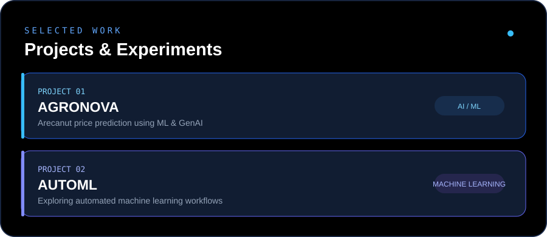
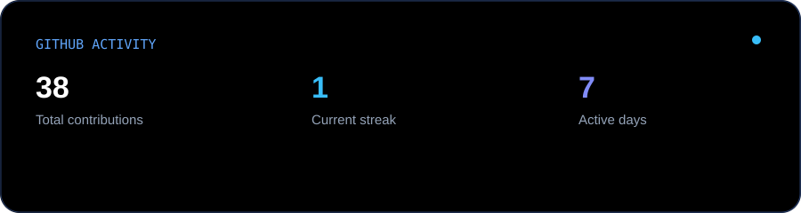
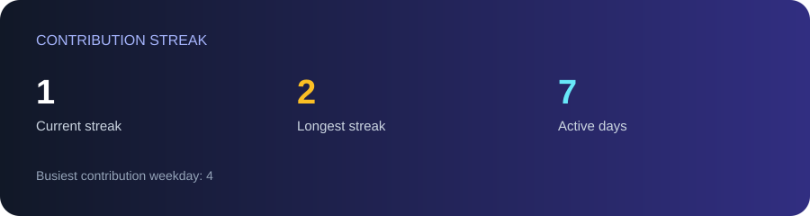

  

# VIGNESH

### AI & Machine Learning Enthusiast | Python Developer

---

## ABOUT ME

- B.E. Artificial Intelligence and Machine Learning student.
- Interested in Python Development, AI and Machine Learning.
- Currently strengthening my programming and problem-solving skills.
- Enjoy building practical projects and exploring new technologies.

## TECH STACK

  

## PROJECTS

  

### Agronova
Arecanut Price Prediction using Machine Learning and GenAI reasoning.

- XGBoost-based price forecasting.
- ResNet50-based soil identification.
- Disease detection and chatbot integration.

### AutoML
An academic project exploring automated machine learning workflows and model selection.

## GITHUB STATISTICS

## CONTRIBUTION ACTIVITY

  
  

